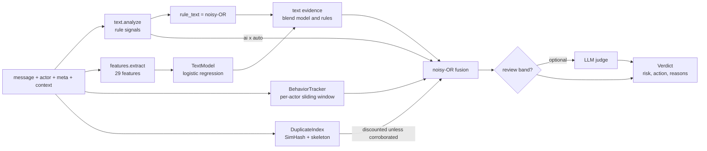

# Architecture

## Pipeline



`SpamDetector.score()` is the only entry point. Pure text work (`text.analyze`, `features`, the model) runs
outside the lock. The per-actor tracker and the duplicate index are shared mutable state and are updated
under one lock, so a single detector instance can serve a threaded server.

## Layer 1: content rules (`text.py`)

Each signal returns a score in 0..1 and a human-readable reason.

| Signal | Idea | Weakness |
|---|---|---|
| `llm_phrases` | density of phrases models over-use ("I hope this message finds you well", "unlock the full potential") | lexicons age as models change; humans copy phrases |
| `burstiness` | humans vary sentence length, LLM prose is more even (needs 4+ sentences) | edited or short text defeats it |
| `punctuation_tics` | em-dashes, "not just X but Y", lists of three, emoji lead | stylistic, easily prompted away |
| `low_specificity` | long text with no numbers, names or concrete details | terse but vague humans |
| `evasion_chars` | zero-width characters, Latin/Cyrillic/Greek mixing inside one word | legit multilingual text in mixed-script tokens (rare) |
| `promo` | promo phrases plus **link reputation** (`url_risk`) | link heuristics are offline and coarse |
| `generic_praise` | praise that could sit under any post; with `context`, low topical overlap with the parent | needs `context` for the strong form |

`url_risk` is deliberately offline: trusted domains (GitHub, Wikipedia, arXiv, `.edu`, `.gov`...) score 0;
cheap TLDs, hyphenated keyword domains and promo path words (`/offer`, `/deal`) raise the score. Plug in a real
reputation feed if you have one.

`analyze()` returns two scores: `ai` (how machine-written it reads) and `spam` (how promotional it is).
Short texts (under 12 words) halve `ai` because the style signals have too little to work with.

## Layer 2: learned text model (`features.py`, `model.py`)

29 numeric features: length, vocabulary diversity, punctuation rates, URL count and risk, contractions,
first-person rate, function-word ratio, **compression ratio** (templated text compresses well), repeated
trigram ratio, the seven rule signals, and context overlap. A logistic regression is trained with Adam on
standardised features with class balancing and L2, in pure Python (about 3 s for 2,000 samples).

The model is a JSON file of weights, means and standard deviations: auditable, diffable, no pickle. `explain()`
returns the features pushing a score up, and the detector adds them to `reasons`. Loading refuses a model
trained on a different feature list.

Only text-distinguishable samples are used as training positives. Stealth-agent messages, whose text is
deliberately normal, are excluded from the text model's target, because only behavior can catch them.

## Layer 3: sender behavior (`behavior.py`)

Per-actor sliding window (default 1 hour, 200 events).

| Signal | Rule |
|---|---|
| `honeypot` | hidden form field filled: certain (risk forced to 1.0) |
| `fill_time` | under 3 s to complete a form, scaled |
| `user_agent` | headless/automation/library UAs (`python-requests`, `HeadlessChrome`, `langchain`, ...); empty UA is mild |
| `regularity` | coefficient of variation of inter-event gaps; humans are bursty (cv around 1+), cron-like agents near 0. Needs 4+ gaps |
| `rate` | events per minute above about 3 |
| `new_account_burst` | account under 1 hour old with 3+ events |

Signals combine as `1 - prod(1 - 0.8 * s)`. This layer is the most robust against LLM-quality text, which is
why it exists. It is also the easiest to evade by an agent that randomises timing and spoofs a browser UA.

## Layer 4: campaign duplication (`similarity.py`)

Two fingerprints per message: a 64-bit **SimHash** over word 3-shingles (survives light paraphrase) and a
**skeleton hash** that masks URLs, digits and capitalised words (survives name/company/link substitution).
A message is compared to a sliding window of recent messages (default 5,000).

Score = `(1 - 0.55^distinct_senders) x length_factor`: more distinct senders sharing a template means higher
evidence, and short texts ("thanks for sharing!") are discounted to nothing below 8 words. This came out of a
benchmark failure: an earlier version blocked about half of ordinary casual messages because short human
phrases repeat naturally. The detector additionally scales duplication by **corroboration**
(`dup_floor` 0.4 + 0.6 x the strongest other signal), so identical benign text alone cannot cause a block.

The index is linear-scan, which is fine for thousands of messages per window. At larger scale, replace it
with an LSH or vector index.

## Fusion (`detector.py`)

```
rule_text  = noisyOR( spam x (0.35 + 0.65 x ai),  0.25 x ai )
text_ev    = blend x model + (1 - blend) x rule_text          # blend = 0.7 with a model, else rules only
corrob     = max(spam, ai, auto, model)
dup_ev     = dup x (0.4 + 0.6 x corrob)
risk       = noisyOR( text_ev,  0.9 x auto,  0.9 x dup_ev,  0.8 x ai x auto )
```

`noisyOR(p...) = 1 - prod(1 - p)`: independent lines of evidence reinforce each other and no single weak
signal can saturate the score. The `ai x auto` term catches a fluent agent on a bot-like cadence even when
neither signal is strong alone. The honeypot forces `risk = 1`.

Actions: `block` at risk >= 0.70, `review` at >= 0.40, otherwise `allow` (`Config.review_at`, `block_at`).
All weights live in `Config`.

**Optional LLM judge.** If you pass `judge=callable(text, verdict) -> float | None`, it is called only for
messages in the review band, and blended in with `judge_weight`. That keeps the expensive call off the hot
path (most traffic is clearly fine or clearly spam) and uses it where uncertainty is highest.

**Trusted actors.** `trusted_actors={"ci-bot"}` skips behavioral scoring for known automation so your own bots
are not flagged for being bots.

## Design decisions

- **Evidence fusion over a single classifier.** Text-only AI detection is unreliable. Behavior and campaign
  structure are independent of how good the prose is, so the system degrades gracefully when text gets better.
- **Explainable by construction.** Every score ships with reasons; the model is a linear JSON file.
- **No dependencies, no network.** Easy to deploy and audit. The cost is coarse heuristics (link reputation,
  lexicons); the hooks (`judge`, `trusted_actors`, swappable model) are where you add stronger components.
- **Review band instead of a hard cutoff.** Uncertain cases go to humans or a judge, and false positives
  against real users are costlier than missed spam in most products.
